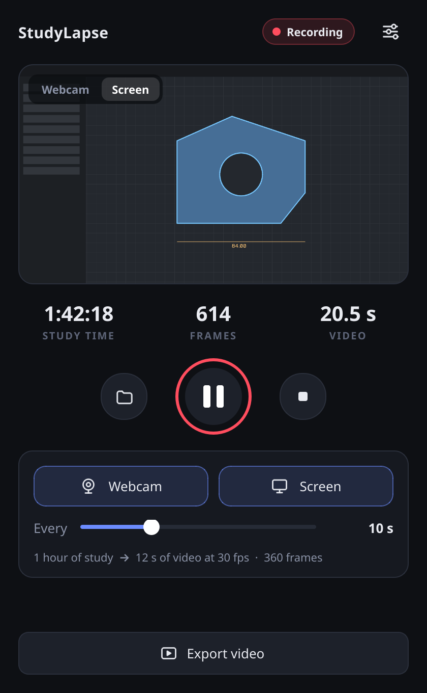

# StudyLapse

A small, light desktop app for **study timelapses**. It sits in the background while you work and saves a
webcam photo and/or a screenshot at whatever interval you choose. When you press stop it **automatically makes
an MP4** you can play straight away: screen with a webcam corner, side by side, vertical for your phone, or one
source only, with an optional study-timer overlay.

Runs on **Windows 10/11** and **Linux** (X11 and Wayland, including Fedora GNOME/KDE).

<p align="center"></p>

## Features

- **Webcam, screen, or both**, every 1 s to 10 min. You can change the interval while it's recording.
- **Locked webcam settings.** When you press record, the webcam auto-adjusts for about 2.5 s, then
  **exposure, gain, focus and white balance are frozen**. Frames don't flicker, change brightness or lose focus.
  The lock is checked against a reference frame, and if a camera resets itself when switched to manual,
  StudyLapse puts the values back or searches for the right exposure.
  There's also a brightness (EV) adjustment, and a **Lock now** button for when the lighting changes.
- **Built to stay out of the way of CAD and other heavy apps** (details below).
- **No audio**: the microphone is never opened.
- Pause/resume without starting a new session. Paused time isn't counted on the study timer.
- Sits in the system tray while recording, so closing the window doesn't stop it.
- **MP4 that plays anywhere.** Exports are H.264 / yuv420p with fast-start, which plays in Windows Media Player,
  the Fedora video player, VLC, phones, browsers, Discord and video editors. An ffmpeg build is included through
  `imageio-ffmpeg`, so there's nothing extra to install.
- **Auto-export.** When you stop a session the MP4 is made in the background, and a **Play** button pops up when
  it's ready. You can also re-export any session at 24/30/60 fps in 720p to 4K, in any layout.

### Why it's light

| What | How |
|---|---|
| Waiting between shots | The capture thread sleeps on an event. Nothing polls, so it uses no CPU. |
| Process priority | Below-normal priority. Windows 11 **Efficiency mode** (EcoQoS) is on. Linux uses `nice 10` and idle I/O priority. |
| Webcam | For intervals of 8 s or more on Windows (20 s or more on Linux), the camera is **released between shots** (its light turns off) and the locked settings are re-applied each time. Shorter intervals keep it open at a low frame rate. |
| Threads | OpenCV is limited to 1 thread, so it never spreads across your cores. |
| UI | When the window is hidden or minimised, no thumbnails are made and the UI timers stop. |
| Export | ffmpeg runs at low priority with 2 threads, so you can keep working while it exports. |

Measured on Linux recording a 1440p screen every 10 s: **under 1% of one CPU core** on average, about 135 MB RAM.

## Install & run

You need Python 3.10 or newer. Everything else, including the ffmpeg used for MP4 export, is installed
automatically on first run.

### Linux

```bash
git clone https://github.com/lexsclav07/TimelapseOnPC.git
cd TimelapseOnPC
./scripts/run-linux.sh                 # first run sets up .venv automatically
./scripts/install-linux-desktop.sh     # optional: adds StudyLapse to your app launcher
```

### Windows

Clone or download the repo, then double-click `scripts\run-windows.bat`. The first run installs what it needs.

There's also a standalone `.exe`: run the **Build** workflow in the GitHub Actions tab, or push a `v*` tag, and
download the `StudyLapse-Windows` artifact. To build it yourself:

```powershell
pip install -r requirements.txt pyinstaller
python packaging/make_ico.py
pyinstaller packaging/studylapse.spec      # -> dist/StudyLapse/StudyLapse.exe
```

## Using it

1. Turn on **Webcam** and/or **Screen**, then set **Every** to your interval.
   The hint under the slider shows how long the video will be per hour of study.
2. Tap the **eye** on the preview to see a live webcam view while you set up the shot.
3. Press the **red button** (or <kbd>Space</kbd>). The webcam calibrates and locks, then recording starts.
   The same button pauses and resumes. **■** stops and saves.
4. Your MP4 is made automatically. Click **Play** on the pop-up to watch it.
   To make a different version (another layout, fps or resolution), click **Export video**
   (<kbd>Ctrl</kbd>+<kbd>E</kbd>). Turn auto-export off in Settings if you'd rather only export by hand.

Settings (<kbd>Ctrl</kbd>+<kbd>,</kbd>) has the camera device and resolution, lock and brightness, whether the
webcam stays on between shots, which monitor to capture and at what resolution, the cursor option, the output
folder, JPEG quality, and tray behaviour.

On Windows there's also **Camera driver settings…**, which opens the webcam's own driver window.
If you'd rather set everything by hand there, turn the auto-lock off.

### Picking an interval

| Interval | 1 h of study becomes (30 fps) |
|---|---|
| 2 s | 60 s |
| 5 s | 24 s |
| 10 s | 12 s |
| 30 s | 4 s |

### Where files go

`~/Videos/StudyLapse/<date_time>/` (you can change this in Settings):

```
2026-11-21_19-04-12/
  webcam/000001.jpg ...
  screen/000001.jpg ...
  frames.csv          # index, timestamp, study-seconds, which sources captured
  session.json        # interval, locked camera values, capture method
  timelapse_pip.mp4   # the video (named after its layout)
```

Frames are plain JPEGs, so you can also put them into any video editor.

## Linux / Wayland notes

Wayland doesn't let apps read the screen directly, so StudyLapse picks the right method for your desktop:

- **GNOME / KDE** (e.g. Fedora Workstation) use the standard **XDG Desktop Portal** screenshot service.
  The first shot may ask for permission. The portal captures **all monitors**, and depending on your desktop
  version each shot may come with a short flash or shutter sound. For short intervals that can get distracting,
  so a webcam-only session or a longer screen interval works best there.
- **Sway / Hyprland / other wlroots desktops** use `grim` (`sudo dnf install grim`).
- **X11** sessions use direct capture, with a choice of monitor.

The webcam uses V4L2. If the lock doesn't seem to hold on your camera, check what it supports with
`v4l2-ctl -d /dev/video0 --list-ctrls` (from the `v4l-utils` package).

## Project layout

```
studylapse/
  app.py            entry point: priority, single instance, theme
  camera.py         webcam open/read, auto-calibrate & lock
  screen.py         screen capture backends (mss / portal / grim / spectacle)
  recorder.py       background capture loop + live preview thread
  exporter.py       session -> MP4 compositor
  config.py         settings (JSON in ~/.config/studylapse or %APPDATA%\StudyLapse)
  ui/               main window, settings, export dialog, widgets, icons, stylesheet
```
